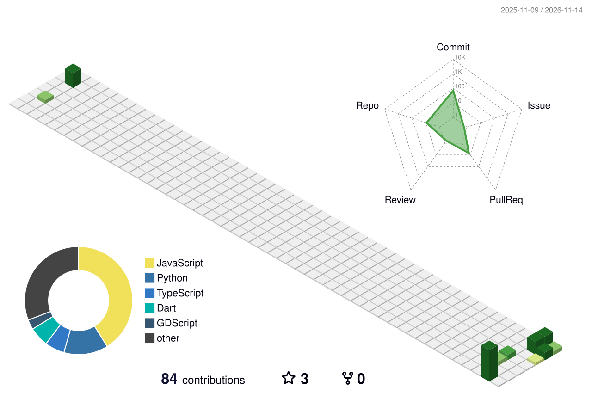

  

  

  
  
  

  

## 👋 Sobre mí

- 🧪 Hago **QA Automation** y validación de sistemas con IA.
- 📊 Estudio **análisis de datos** y me gusta contar historias con gráficos.
- 🛠️ Armo herramientas chicas que cualquiera pueda abrir y usar, y las pruebo en serio: cada proyecto tiene sus tests en GitHub Actions.
- 🎮 Hago juegos en **Godot** y 🎹 música en **Ableton**.
- 💬 Hablemos de testing, datos, IA local o lo que estés armando.

---

## 🚀 Proyectos

### 📄 [CV ATS Optimizer](https://github.com/scheffan/cv-ats-optimizer) · **[Probalo online](https://scheffan.github.io/cv-ats-optimizer/)**

Web gratuita que adapta tu CV a una oferta laboral y lo exporta a PDF y LaTeX de una columna, pensado para pasar filtros ATS. Lee el CV en el navegador, no inventa experiencia y marca aparte lo que la oferta pide y tu CV no tiene.

`JavaScript` `Cloudflare Workers` `LLM (Groq)` `LaTeX` `Playwright`

### 🧪 [QA con Playwright: E2E + seguridad](https://github.com/scheffan/qa-demo-playwright)

Suite de pruebas de un e-commerce de punta a punta, más pruebas de seguridad básicas (cabeceras, cookies, validación de entradas) y un escaneo con OWASP ZAP. Todo corre solo en cada push.

`TypeScript` `Playwright` `OWASP ZAP` `GitHub Actions`

### 🕹️ [Faro](https://github.com/scheffan/g-faro)

Plataformero 2D en Godot pensado como pieza de game testing: 40 tests automáticos con GUT que corren sin pantalla en CI.

`Godot` `GDScript` `GUT` `GitHub Actions`

### 🎧 [Música y salud mental](https://github.com/scheffan/musica-y-salud-mental)

Análisis exploratorio de una encuesta a 736 personas sobre hábitos musicales, ansiedad, depresión e insomnio. Limpieza de datos con tests y conclusiones explicadas con gráficos.

`Python` `pandas` `Jupyter` `pytest`

### 🎵 [SoundWave Player](https://github.com/scheffan/soundwave_player)

Reproductor de música para Android que funciona sin internet, con playlists, ecualizador y un buscador de radios online. El APK se compila y publica solo con cada cambio.

`Flutter` `Dart` `Android` `SQLite`

### 🚌 [Chatbot de colectivos CABA](https://github.com/scheffan/chatbot_autobus_caba)

Chatbot que busca cómo ir de una dirección a otra en colectivo con datos GTFS oficiales de la Ciudad, por web o Telegram.

`Python` `FastAPI` `GTFS` `Telegram`

### 🖼️ [ScreenToText](https://github.com/scheffan/ScreenToText)

Seleccionás una parte de la pantalla y el texto queda copiado en el portapapeles. Sirve para copiar de páginas o imágenes que no dejan seleccionar texto.

`Python` `EasyOCR` `Tkinter`

### Otros trabajos

- **Análisis de sentimiento en Reddit (NLP):** clasificación de conversaciones con modelos de lenguaje en Python.
- **Clasificación de imágenes y detección de objetos:** entrenamiento de CNN y YOLO con PyTorch y TensorFlow, con métricas de accuracy, recall y mAP.
- **Análisis forense de memoria RAM:** detección de procesos, malware y anomalías de red con Volatility 3.

---

## ⚡ Qué hago

- **QA Automation y validación de IA:** pruebas de agentes basados en GPT (texto, imágenes y razonamiento), diseño de casos a partir de historias de usuario, criterios de aceptación y pruebas E2E entre backend, frontend y base de datos.
- **Análisis de datos y KPIs:** análisis exploratorio, SQL y ETL, definición de métricas (latencia p95, uptime, detecciones).
- **Observabilidad:** dashboards en Grafana con métricas de PostgreSQL y CloudWatch, y estandarización de logs para servicios de IA.
- **Web:** sitios con HTML, CSS, JavaScript y WordPress, mejoras de UX/UI y soporte técnico.

## 🧰 Herramientas

  
   
  

  
  
  
  
  
  

---

## 📈 Actividad

  <picture>
    <source media="(prefers-color-scheme: dark)" srcset="https://raw.githubusercontent.com/scheffan/scheffan/output/profile-3d-contrib/profile-night-rainbow.svg" />
    
  </picture>

  <picture>
    <source media="(prefers-color-scheme: dark)" srcset="https://raw.githubusercontent.com/scheffan/scheffan/output/github-contribution-grid-snake-dark.svg" />
    
  </picture>

<b>Siempre aprendiendo. Siempre construyendo.</b>

  

